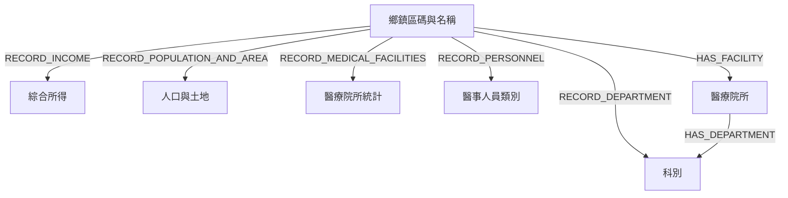

# 整合後本機 Neo4j Schema

更新日期：2026-10-15（Asia/Taipei）。實際版本 Neo4j 2026.09.0 Enterprise。

## 資料庫與語意

- `medicalfacilities`：來源庫，保留 23,238 個 `MedicalFacility`、44 個 `Department`、28,631 條 `HAS_DEPARTMENT`；本次不修改。
- `neo4j`：網站統一讀取的目標庫；官方統計與目前院所清單共存，科別共用名稱節點但以不同關係表示資料意義。
- `PROVIDE_DEPARTMENT` 在本次盤點前已為 0；既有 `RECORD_DEPARTMENT` 為 6372，因此更名流程略過，不再 CREATE 或 DELETE。

## 節點及屬性

| Label | 整合前 | 整合後 | 屬性／資料口徑 |
| --- | ---: | ---: | --- |
| 鄉鎮區碼與名稱 | 368 | 368 | 鄉鎮市區碼（字串）、鄉鎮市區名稱（完整縣市行政區名稱） |
| 綜合所得 | 368 | 368 | 鄉鎮市區名稱、納稅單位(戶)、綜合所得總額、平均數、中位數、第一分位數、第三分位數及既有屬性；金額千元 |
| 人口與土地 | 368 | 368 | 鄉鎮市區名稱、年底人口數、土地面積、人口密度及既有屬性 |
| 醫療院所統計 | 525 | 525 | 類型、院所家數、醫事人員總計及既有屬性；行政區／類型彙總 |
| 醫事人員類別 | 27 | 27 | 人員類別及既有屬性 |
| 科別 | 45 | 53 | 科別名稱；新建的 8 個院所獨有節點另有 _integrationOwner；原 45 個節點屬性完全不變 |
| 醫療院所 | 0 | 23238 | 完整複製原 MedicalFacility 屬性，另加 _integrationOwner 標示管理來源 |

原院所屬性共盤點 15 個鍵，全部保留原始值與型別：
`sourceId`、`name`、`address`、`type`、`latitude`、`longitude`、`phone`、`notes`、`clinicTimeJson`、`source`、`county`、`district`、`districtCode`、`districtAssignmentSource`、`districtCoordinateConflict`。
缺失屬性保持缺失，不自行填入 null 或空字串；數值、字串、布林及其他 Neo4j 型別由 PropertyCodec 保留。
沒有把欄位改為中文，也沒有將來源 Department 以第二個 Label 複製至目標。

## 關係

| 起點 → 終點 | 關係 | 整合前 | 整合後 | 屬性 |
| --- | --- | ---: | ---: | --- |
| 行政區 → 綜合所得 | RECORD_INCOME | 368 | 368 | 原有統計年 112 與全部既有屬性 |
| 行政區 → 人口與土地 | RECORD_POPULATION_AND_AREA | 368 | 368 | 原有統計年 114 與全部既有屬性 |
| 行政區 → 醫療院所統計 | RECORD_MEDICAL_FACILITIES | 525 | 525 | 原有統計年 114 與全部既有屬性 |
| 行政區 → 醫事人員類別 | RECORD_PERSONNEL | 6309 | 6309 | 類型、數量及其他原有屬性 |
| 行政區 → 科別 | RECORD_DEPARTMENT | 6372 | 6372 | 類型、數量及其他原有屬性，不補假定的統計年 |
| 行政區 → 醫療院所 | HAS_FACILITY | 0 | 23238 | matchMethod、_integrationOwner |
| 醫療院所 → 科別 | HAS_DEPARTMENT | 0 | 28631 | 全部來源關係屬性、原始科別名稱、來源關係鍵、_integrationOwner |

官方 1,701 個原節點及 13,942 條原關係的端點、ID、方向與全部屬性已逐筆確認不變。
科別統計的數量不來自院所即時關係加總；共用科別節點不表示兩份資料的統計口徑相同。
每間院所最多一個確定行政區，本次 23,238 筆 matched、0 unmatched、0 ambiguous。
94 筆沿用已有驗收紀錄的使用者核准代碼，23,144 筆依完整地址前綴。

## 約束及索引

目標既有約束保留：
`鄉鎮市區碼_鄉鎮區碼與名稱_key`（NODE_KEY）、`personnel_category_unique`。
新增三項唯一性約束及其 backing RANGE index：

| 名稱 | 唯一鍵 |
| --- | --- |
| integration_facility_source_id | 醫療院所.sourceId |
| integration_department_name | 科別.科別名稱 |
| integration_department_relation_key | HAS_DEPARTMENT.來源關係鍵 |

既有 NODE／RELATIONSHIP LOOKUP indexes 與統計 RANGE indexes 都保留。
來源 medical_facility_source_id、medical_department_name 及索引定義不變。
readCount、lastRead 等查詢使用統計會自然改變，稽核不將這些當成資料屬性變更。

## 44 個來源科別對照

34 個原名完全相同、2 個明確別名、8 個院所獨有名稱；標準化後實際院所有 42 個不同科別，與官方 45 個名稱的聯集為 53。
來源關係全數保留；本次沒有重複原始關係、標準化後同院所碰撞或異常科別。

| 原名 | 標準名 | 規則 | 來源關係數 | 目標追溯關係數 |
| --- | --- | --- | ---: | ---: |
| 一般精神科 | 一般精神科 | 獨有 | 2 | 2 |
| 不分科 | 不分科 | 獨有 | 2587 | 2587 |
| 中醫一般科 | 中醫一般科 | 完全相同 | 4172 | 4172 |
| 兒科 | 兒科 | 完全相同 | 1586 | 1586 |
| 兒童牙科 | 兒童牙科 | 完全相同 | 9 | 9 |
| 兒童青少年精神科 | 兒童青少年精神科 | 獨有 | 2 | 2 |
| 內科 | 內科 | 完全相同 | 2123 | 2123 |
| 口腔顎面外科 | 口腔顎面外科 | 完全相同 | 33 | 33 |
| 外科 | 外科 | 完全相同 | 876 | 876 |
| 婦產科 | 婦產科 | 完全相同 | 885 | 885 |
| 家庭牙醫科 | 家庭牙醫科 | 完全相同 | 25 | 25 |
| 家庭醫學科 | 家庭醫學科 | 完全相同 | 275 | 275 |
| 家醫科 | 家庭醫學科 | 同義 | 1633 | 1633 |
| 復健科 | 復健科 | 完全相同 | 822 | 822 |
| 急診醫學科 | 急診醫學科 | 完全相同 | 199 | 199 |
| 成癮防治科 | 成癮防治科 | 獨有 | 2 | 2 |
| 放射線科 | 放射線科 | 獨有 | 4 | 4 |
| 放射腫瘤科 | 放射腫瘤科 | 完全相同 | 98 | 98 |
| 放射診斷科 | 放射診斷科 | 完全相同 | 240 | 240 |
| 整形外科 | 整形外科 | 完全相同 | 166 | 166 |
| 核子醫學科 | 核子醫學科 | 完全相同 | 84 | 84 |
| 泌尿科 | 泌尿科 | 完全相同 | 339 | 339 |
| 洗腎科 | 洗腎科 | 獨有 | 4 | 4 |
| 牙周病科 | 牙周病科 | 完全相同 | 6 | 6 |
| 牙科 | 牙科 | 獨有 | 6981 | 6981 |
| 牙醫一般科 | 牙醫一般科 | 完全相同 | 184 | 184 |
| 牙髓病科 | 牙髓病科 | 完全相同 | 2 | 2 |
| 特殊需求者口腔醫學科 | 特殊需求者口腔醫學科 | 完全相同 | 4 | 4 |
| 病理科 | 病理科 | 獨有 | 7 | 7 |
| 皮膚科 | 皮膚科 | 完全相同 | 595 | 595 |
| 眼科 | 眼科 | 完全相同 | 918 | 918 |
| 神經外科 | 神經外科 | 完全相同 | 168 | 168 |
| 神經科 | 神經科 | 完全相同 | 369 | 369 |
| 精神科 | 精神科 | 完全相同 | 618 | 618 |
| 耳鼻喉科 | 耳鼻喉科 | 完全相同 | 1256 | 1256 |
| 耳鼻喉科(耳鼻喉頭頸外科) | 耳鼻喉科 | 同義 | 4 | 4 |
| 職業醫學科 | 職業醫學科 | 完全相同 | 103 | 103 |
| 臨床病理科 | 臨床病理科 | 完全相同 | 47 | 47 |
| 西醫一般科 | 西醫一般科 | 完全相同 | 59 | 59 |
| 解剖病理科 | 解剖病理科 | 完全相同 | 124 | 124 |
| 贋復補綴牙科 | 贋復補綴牙科 | 完全相同 | 2 | 2 |
| 骨科 | 骨科 | 完全相同 | 755 | 755 |
| 麻醉科 | 麻醉科 | 完全相同 | 244 | 244 |
| 齒顎矯正科 | 齒顎矯正科 | 完全相同 | 19 | 19 |

`牙科`不等同`牙醫一般科`，`不分科`不等同`西醫一般科`，`一般精神科`不等同`精神科`，`放射線科`不等同其他放射科別。
`中醫針灸科`等統計獨有名稱保留；Java 單元測試覆蓋這些不合併規則。
原名保留在關係上，追溯鍵由來源庫名稱、院所 sourceId、來源關係 elementId 計算。
來源庫不可重建後沿用此基準，詳見[管理文件](neo4j-integration-operations.md)。

## 查詢與分類

行政區院所查詢只經 HAS_FACILITY；實際科別只經 HAS_DEPARTMENT，不以 RECORD_DEPARTMENT 推測院所提供某科。
查詢使用 DISTINCT／EXISTS，平行科別關係不產生重複院所或標記。
醫院四類：醫院、綜合醫院、精神科醫院、中醫醫院。
診所十類：一般診所(醫務室)、中醫一般診所、中醫專科診所、中醫診所、牙醫一般診所、牙醫專科診所、牙醫診所、西醫診所、西醫診所(醫務室)、專科診所。
13 筆病理中心也完整複製，但延續原搜尋口徑，不列入醫院／診所篩選。
官方科別選擇器仍為 45 項，實際院所科別選單為 42 項。
